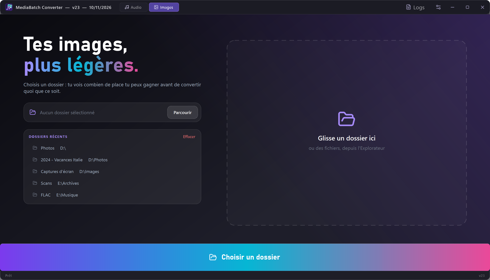
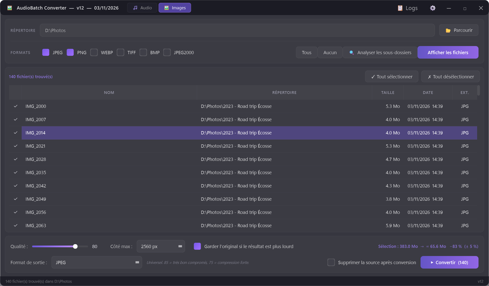
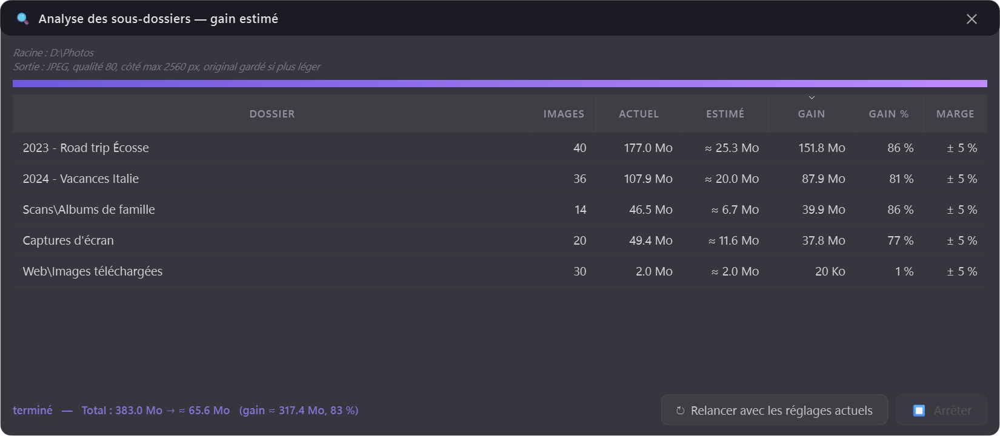

# 🎵 AudioBatch Converter

**Batch-convert your music library — FLAC, WAV, APE, OGG, M4A and more to MP3, OGG or Opus — with tags and cover art preserved. Now also batch-converts images (PNG/JPEG → JPEG, JPEG 2000, WebP) and tells you how much space you'll save before you start.**

Point it at a folder: it scans everything, converts in parallel, keeps your metadata, and — in Images mode — estimates the size of the result before converting anything.



## Two modes

Switch between **🎵 Audio** and **🖼 Images** from the title bar (the app remembers the last one used).

### 🖼 Images mode



- **Inputs**: JPEG, PNG, WebP, TIFF, BMP, JPEG 2000 → **Outputs**: JPEG, JPEG 2000, WebP, PNG (lossless).
- **Quality slider** per format, optional **downscaling** (longest side 1024 → 4096 px).
- **EXIF, colour profile and DPI preserved**; file modification date kept (your photos stay sorted by date).
- PNG transparency is flattened onto white for JPEG.
- **"Keep the original if the result is larger"** — re-compressing an already well-compressed JPEG never makes it heavier.
- **Live size estimate** of the selection (`383 MB → ≈ 66 MB, −83 % (± 5 %)`), updated as you move the quality slider.
- **Subfolder analysis**: scans every subfolder and lists, in a sortable table, where the conversion would free the most space. Double-click a folder to load it into the converter.



#### How the estimate works

Nothing is written to disk. The app reads the header of every image (dimensions and, for JPEGs, the quantization tables — i.e. the quality the file was originally saved at), converts a small sample in memory, fits a model of *compression ratio vs. original quality*, and extrapolates to every file. More samples are added until the margin is tight enough. On real photo folders the estimate lands within a few percent of the actual result; the displayed margin (`± x %`) is deliberately conservative.

On a USB hard drive, analysing ~11,000 photos across 200 folders takes about 5 minutes (header reads dominate); it is much faster on an SSD, and results appear folder by folder.

## Features (Audio mode)

- **Batch conversion** of a whole folder tree, in parallel (all CPU cores).
- **Formats**: FLAC, WAV, APE, OGG, M4A, WMA, AIFF… → MP3, OGG, Opus, and more, with per-format quality settings.
- **Tags & cover art preserved** through conversion (mutagen + FFmpeg).
- **Tag editor** with batch editing, filename-pattern deduction (`Artist - Title`…), and **MusicBrainz auto-tagging** (official API, rate-limit friendly).
- **Preview player** to check files before/after.
- **FFmpeg auto-setup**: on first run the app offers to download FFmpeg (BtbN build) — nothing to install manually, nothing bundled in this repository.
- Dark themed PyQt6 UI, detailed logs window.

## Installation

Requires **Windows** and **Python 3.12+**.

```bash
git clone https://github.com/hypedigger/AudioBatch-Converter.git
cd AudioBatch-Converter
pip install -r requirements.txt
python main.py
```

On first launch, accept the FFmpeg download (or point the app at an existing FFmpeg).

## Usage

1. Pick **Audio** or **Images** in the title bar, then choose a folder — the scanner lists every convertible file.
2. Pick the output format and quality (Images: check the size estimate, or run **Analyze subfolders** first).
3. Convert. Covers and tags (audio) or EXIF (images) follow automatically.
4. Optional (audio): open the tag editor to fix metadata, or let MusicBrainz fill the gaps.

Settings and logs are local files (`config.json`, `logs/`) and are not part of the repository.

## Notes

- Images are processed with [Pillow](https://python-pillow.org/) (installed automatically on first run); FFmpeg is only needed for audio.
- Conversion only touches **your local files** — nothing is downloaded from or uploaded to any music service.
- FFmpeg is GPL; it is downloaded separately from [BtbN/FFmpeg-Builds](https://github.com/BtbN/FFmpeg-Builds) and never redistributed here.
- MusicBrainz lookups follow their [API etiquette](https://musicbrainz.org/doc/MusicBrainz_API/Rate_Limiting) (identified User-Agent, 1 request/s).
- UI is currently in French; contributions welcome.

## Support

If AudioBatch Converter saved your library migration:

[](https://ko-fi.com/hypedigger)

## License

[MIT](LICENSE)
