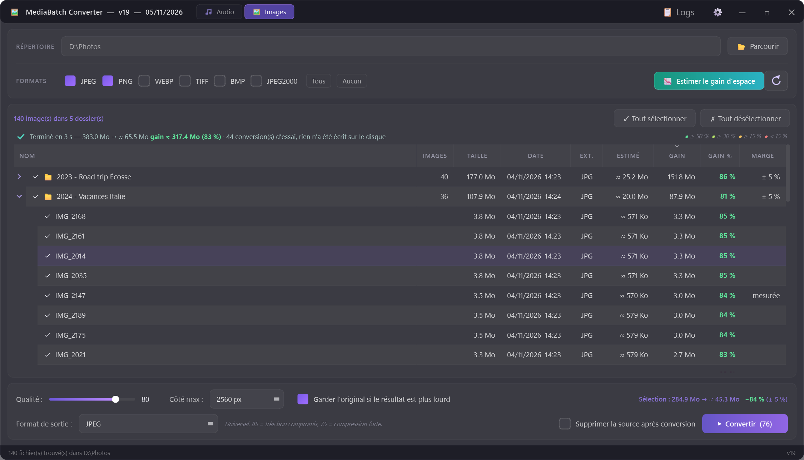

# 🎵🖼 MediaBatch Converter

*Formerly **AudioBatch Converter** — renamed in v14 now that it converts images too.*

**Batch-convert your music library — FLAC, WAV, APE, OGG, M4A and more to MP3, OGG or Opus — with tags and cover art preserved. Now also batch-converts images (PNG/JPEG → JPEG, JPEG 2000, WebP) and tells you how much space you'll save before you start.**

Point it at a folder: it scans everything, converts in parallel, keeps your metadata, and — in Images mode — estimates the size of the result before converting anything.


## Two modes

Switch between **🎵 Audio** and **🖼 Images** from the title bar (the app remembers the last one used).

### 🖼 Images mode


- **Inputs**: JPEG, PNG, WebP, TIFF, BMP, JPEG 2000 → **Outputs**: JPEG, JPEG 2000, WebP, PNG (lossless).
- **Quality slider** per format, optional **downscaling** (longest side 1024 → 4096 px).
- **EXIF, colour profile and DPI preserved**; file modification date kept (your photos stay sorted by date).
- PNG transparency is flattened onto white for JPEG.
- **"Keep the original if the result is larger"** — re-compressing an already well-compressed JPEG never makes it heavier.
- **Live size estimate** of the selection (`383 MB → ≈ 66 MB, −83 % (± 5 %)`), updated as you move the quality slider.
- **Folder view**: images are grouped by folder, folders start collapsed (images sitting directly in the chosen folder are listed on their own). Tick a folder to select all its images.
- **Estimate space savings** (teal button): fills the *Estimated / Gain / Gain % / Margin* columns right in the list, for every folder and every image — gain % colour-coded from *worth it* (green) to *barely useful* (red), images used as test conversions marked *measured*. A live activity line shows what is being done; sort any column at any time; click again to stop.
- When you pick a folder, a small notification offers to estimate the savings — ignore it and it fades away after a few seconds.



#### How the estimate works

Nothing is written to disk. The app reads the header of every image (dimensions and, for JPEGs, the quantization tables — i.e. the quality the file was originally saved at), converts a small sample in memory, fits a model of *compression ratio vs. original quality*, and extrapolates to every file. More samples are added until the margin is tight enough. When estimating a whole folder tree, the app first learns the common trend (how compression varies with the original quality) from images spread across all folders, so each folder only needs a few test conversions of its own — heterogeneous folders automatically get more. On real photo folders the estimate lands within a few percent of the actual result; the displayed margin (`± x %`) is deliberately conservative.

On a hard drive, reading every header costs one disk seek per file. For folders of more than 300 images, the app first reads 300 headers spread across the folder: if the folder is homogeneous (camera photos: a handful of JPEG quality levels), the rest is extrapolated from file sizes — reading more headers if needed — and only those images are marked as extrapolated. Heterogeneous folders (downloaded images with dozens of quality levels) are still read in full, to keep the estimate accurate. Results appear folder by folder.

## Features (Audio mode)

- **Batch conversion** of a whole folder tree, in parallel (all CPU cores).
- **Formats**: FLAC, WAV, APE, OGG, M4A, WMA, AIFF… → MP3, OGG, Opus, and more, with per-format quality settings.
- **Tags & cover art preserved** through conversion (mutagen + FFmpeg).
- **Tag editor** with batch editing, filename-pattern deduction (`Artist - Title`…), and **MusicBrainz auto-tagging** (official API, rate-limit friendly).
- **Preview player** to check files before/after.
- **FFmpeg auto-setup**: on first run the app offers to download FFmpeg (BtbN build) — nothing to install manually, nothing bundled in this repository.
- Dark themed PyQt6 UI, detailed logs window.

## Download

Grab **`MediaBatch-Converter.exe`** from the [latest release](https://github.com/hypedigger/MediaBatch-Converter/releases/latest) — a single portable file, no Python needed. Put it in its own folder: settings, logs and the FFmpeg download are stored next to it.

Windows SmartScreen may warn about an unsigned app: click *More info → Run anyway*.

## Installation from source

Requires **Windows** and **Python 3.12+**.

```bash
git clone https://github.com/hypedigger/MediaBatch-Converter.git
cd MediaBatch-Converter
pip install -r requirements.txt
python main.py
```

On first launch, accept the FFmpeg download (or point the app at an existing FFmpeg) — only needed for audio.

Optional — add the app to the Start menu (current user, no admin rights):

```powershell
powershell -ExecutionPolicy Bypass -File create_shortcut.ps1
```

Build the standalone exe yourself with `powershell -File build_exe.ps1` (output: `dist\MediaBatch-Converter.exe`).

## Usage

1. Pick **Audio** or **Images** in the title bar, then choose a folder — its convertible files are listed right away (the ↻ button re-reads the folder after you change the format filters or the files on disk).
2. Pick the output format and quality (Images: check the size estimate, or click **Estimate space savings** first).
3. Convert. Covers and tags (audio) or EXIF (images) follow automatically.
4. Optional (audio): open the tag editor to fix metadata, or let MusicBrainz fill the gaps.

Settings and logs are local files (`config.json`, `logs/`) and are not part of the repository.

## Notes

- Images are processed with [Pillow](https://python-pillow.org/) (installed automatically on first run); FFmpeg is only needed for audio.
- Conversion only touches **your local files** — nothing is downloaded from or uploaded to any music service.
- FFmpeg is GPL; it is downloaded separately from [BtbN/FFmpeg-Builds](https://github.com/BtbN/FFmpeg-Builds) and never redistributed here.
- MusicBrainz lookups follow their [API etiquette](https://musicbrainz.org/doc/MusicBrainz_API/Rate_Limiting) (identified User-Agent, 1 request/s).
- UI is currently in French; contributions welcome.

## Support

If this tool saves you time, you can support its development on [Ko-fi](https://ko-fi.com/hypedigger).

[](https://ko-fi.com/hypedigger)

## License

[MIT](LICENSE)
